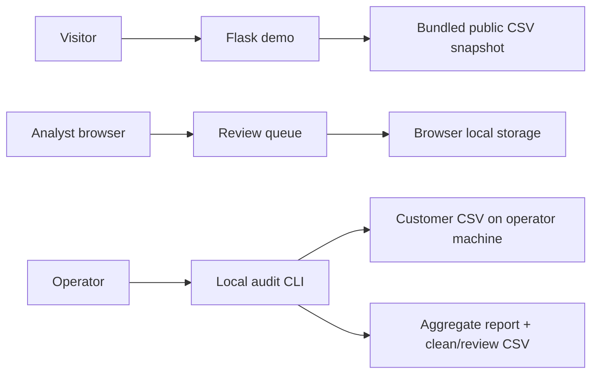
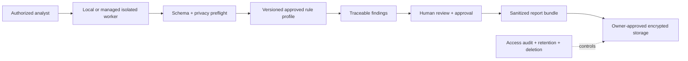

# ReelMetrics architecture

## Current

The web dashboard reads a bundled snapshot and does not accept customer files. The CLI processes private files locally, makes no network requests, and writes local reports. It is a local audit/service prototype, not a multi-tenant SaaS. The bundled dataset's commercial redistribution rights remain unverified.

## Proposed after paid workflow is proven

This is a future boundary, not current behavior. Do not upload customer CSVs until data retention, encryption, access roles, deletion/export, region, incident response, backup behavior, and a paid buyer use case are approved.

## ADR-001 — keep customer audits local by default

- **Status:** Accepted, 2026-11-17.
- **Decision:** Keep private catalog audit files local to the operator; use the live site only for the bundled demo dataset. Do not add anonymous uploads or an AI service call.
- **Reason:** Catalog exports can contain confidential business data or personal information, and this repo has no approved retention, tenant access, account deletion, or restore controls.
- **Revisit when:** buyers validate the workflow and an owner-approved privacy/security design defines storage, access, retention, restore and support responsibilities.

## Operational boundaries

- Treat client rows and reports as confidential; keep them outside Git and use a customer-approved destination.
- Reports should contain aggregate metrics and source-row references only when that is enough for remediation; never include more source data than the buyer requests.
- Confirm dataset and third-party mark rights before commercial use; this repository's code license does not grant data rights.
- Re-run CLI tests and the web dashboard tests after changing parsers, profiles, export formats, or local storage behavior.
